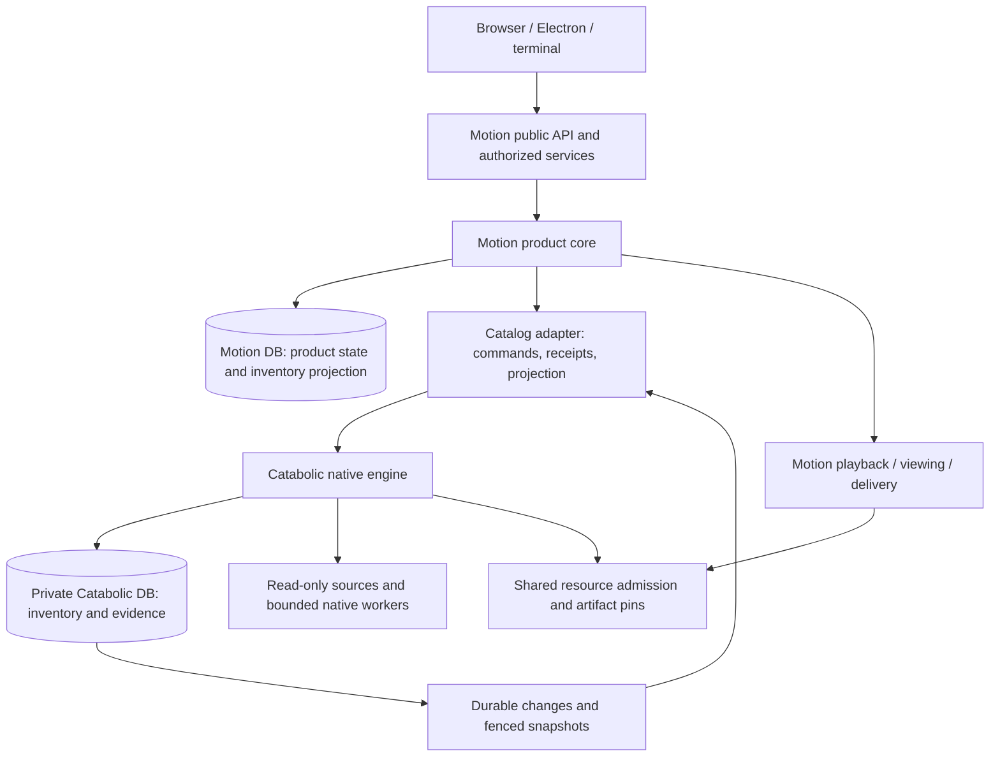

# Catabolic Rust as Motion's catalog backend

**Assessment date:** October 12, 2026. **Status:** integration proposal, not an implementation or cutover decision. This is a static review of both repositories and the supplied migration plan. No builds, tests, live catalog operations, or service changes were performed.

## 1. Recommendation

Catabolic is a plausible reusable **inventory and media-evidence backend** for Motion. Adopt that boundary first: source bindings and trust, guarded observations, physical file inventory, freshness and coverage, and eventually revision-bound probe/component evidence. Keep Motion's logical libraries, works/editions/timelines, matching decisions, curated metadata, viewing state, access control, delivery, and clients in Motion. This removes duplicate inventory machinery while preserving the product semantics that Catabolic does not provide directly.

This is a substantial integration project. It is not a dependency substitution, a database import, or a way to declare the remaining Motion completion work finished. Catabolic's native implementation now contains much of the necessary behavior, but the current branch explicitly remains experimental and has unresolved qualification and filesystem-safety gaps.

The proposed storage arrangement is a **private Catabolic-owned database plus Motion's application database**, with a durable, revision-aware projection between them. Each fact has one owner. Motion's projected physical inventory is a read model; it is not a second writer of Catabolic facts. Motion remains the only public application/API and the only authority for its product semantics.

Prefer in-process Rust calls if an early dependency spike establishes a supportable shared SQLite binding and toolchain. The current manifests cannot be linked unchanged. If convergence requires a disruptive SQLx/storage migration, use one supervised private native engine process instead, with the same bounded operation contract. Select one deployment before implementation; do not build and maintain both transports speculatively.

Start with a read-only comparison against a disposable catalog, then one original-media source. Defer generated-output ownership and processing delegation. Do not connect Motion to the user's existing standalone Catabolic database or let both applications manage the same output roots.

## 2. What this assessment is based on

| Input | Reviewed identity and significance |
|---|---|
| Motion | `main`, `28f4b32c0df0c31d636488fdb524c23549c89bdc`; current schema migrations extend through `0044`. Existing local completion-plan changes and the untracked handoff were preserved. |
| Motion completion target | [Single-agent handoff](MOTION_SINGLE_AGENT_COMPLETION_HANDOFF.md), [final architecture](Motion_Final_Architecture_and_Implementation_Plan.md), and [completion plan](MOTION_CONSOLIDATION_AND_COMPLETION_PLAN.md). |
| Companion review | [Motion rewrite code review](MOTION_REWRITE_CODE_REVIEW.md). Its findings remain open considerations; this proposal does not repair them. |
| Supplied Catabolic migration plan | `catabolic-rust-migration-plan.md`, prepared October 9, baseline `453fca983222c6665a48775eef67c489c96b527e`; supplied attachment SHA-256 `0a64213924d8b23407a1352a80383892f4bbd8c08b31e265bf7a5b06b5cd277a`. |
| Reviewed Catabolic implementation | `codex/rust-migration-m4-plus`, `0d13caafed7790c4c7c69e203d4d6132372c3c7c`, tree `456a540de3e16a96d696dbaee0325f80d066a730`, in the reviewed Catabolic checkout. This imports the checkpoint-14 source snapshot. The checkout advanced during review; the relevant engine boundaries were rechecked against this imported commit. |
| Current Catabolic status | October 13 stop handoff (`Catabolic/docs/RUST_MIGRATION_STOP_2026_10_13.md`) and native-first sequencing (`Catabolic/docs/RUST_MIGRATION_NATIVE_FIRST.md`) supersede the older paused/M2–M4 summaries. The handoff names original source commit `208d57f`; the local import has the distinct Git identity above. Historical receipts are not fresh verification of this import. |
| Concurrent Catabolic changes excluded | Changes in `.github/workflows/standalone-native.yml`, `tests/standalone-native-ci-contract.sh`, and `tests/test_native_qualification_receipts.py` were left untouched and subsequently appeared in commit `f62124c9b9cb6f2e9a856129a6b4271b6e62beec`. Its diff from the reviewed baseline contains only those three workflow/test files. This is a selected integration-boundary review, not an exhaustive audit of the imported rewrite or that follow-up. |

The two plans have different milestone numbering. `C-M5` below means Catabolic's observation milestone; Motion's `M5` is its own downloads/offline lane. New `I0–I6` stages below are integration stages.

### Current Rust availability versus readiness

The current workspace has `catabolic-core`, `catabolic-store`, `catabolic-runtime`, `catabolic-http`, CLI, distribution, Python, and verification crates. It has real native observation, media processing, rendition/component, reconciliation, playback, and public facade implementations. Describing it as a read-only M3 library would now be incorrect. [C1, C2, C4]

However, the latest stop handoff says **no milestone hard gate is closed, including C-M0–C-M3 prerequisites**, and Python remains the installed default. Sequencing now prioritizes the standalone native engine/CLI, with the thin Python wrapper last. Earlier SQL-refusal diagnostics and fallback handle-release defects have focused fixes; the old failed aggregate remains historical evidence, not a current unfixed-defect list. Checkpoint 13 retains CLI/configuration failures and unexecuted later stages; checkpoint 14's combined aggregate and same-source standalone candidate had not started. Native macOS event/filesystem acceptance, production publication/recovery/content protection and broader safety review remain open. [C1]

Motion need not wait for every standalone Catabolic notification provider, Python facade, or Plex workflow. It does need an explicitly qualified subset at an exact engine/helper revision, including that subset's storage, filesystem, platform, recovery, and packaging dependencies. Existing failed gates must be resolved or precisely scoped; they cannot be relabeled as successful integration evidence.

## 3. Architecture decisions that would change

Motion's final plan currently binds D02 to a Motion-owned catalog with Catabolic as reference only, and D03 to one Motion-owned SQLite database. It also excludes an internal Catabolic RPC/service and says `motion-catalog` must not depend on `catabolic-*`. This proposal deliberately reopens those choices; it does not quietly claim compatibility with them. [M1]

Before implementation, record an ADR that:

1. Changes D02 to permit a qualified Catabolic inventory/evidence engine, while retaining Motion's product-domain authority.
2. Changes D03 to two explicitly owned stores and specifies synchronization, backup, restoration, and failure semantics. A single installed product does not make two SQLite commits atomic.
3. Retains D04's bounded execution ownership, or explicitly permits one private supervised engine process if that deployment is selected.
4. Retains one public `/api/v2`, read-only originals, shared production-core verification, Demuxe, and the current client architecture.
5. Updates the architecture's acceptance language, packaging requirements, reference register, and completion backlog. Preserve the original plans as history rather than editing their imported claims to imply this was always the design.

The supplied Catabolic plan also freezes schema 32 for its compatibility release. A new durable catalog feed or receipt table is an engine schema change, even if Motion is its first consumer. Schedule it through Catabolic's migration owner after the relevant compatibility gate, or explicitly amend that freeze with a tested compatibility/rollback policy. Do not add hidden Motion tables to a schema-32 database.

## 4. Integration options

| Option | Fit and cost | Recommendation |
|---|---|---|
| Keep adapting Catabolic reference behavior | Preserves Motion's current architecture and avoids runtime coupling; both projects continue maintaining similar scanner/evidence logic. | Valid fallback if actual reuse does not justify integration cost. |
| Embed Catabolic with its own private database | Reuses the store/runtime and keeps ordinary calls in-process; requires dependency convergence, bounded blocking execution, and a durable projection protocol. | Preferred target if the early dependency gate passes. |
| Supervise a private native Catabolic process with its own database | Avoids one Cargo graph's SQLite conflict and isolates engine failures; adds IPC framing, lifecycle, cancellation, protocol versioning, and another packaged executable. | Practical alternative if direct linking is too disruptive. It is a deliberate architecture change, not free isolation. |
| Put current Catabolic and Motion tables in one database | Table names already overlap; Catabolic validates the entire schema and owns its migration history. SQLx and rusqlite connections still cannot share an ordinary transaction just because the filename is the same. | Reject as a shortcut. |
| Extract a storage-independent Catabolic engine into Motion's schema | Could preserve one database, but needs repository/transaction ports, host-owned persistence, rewritten adapters, and qualification alongside standalone Catabolic. | A separate, larger project if one database is a hard requirement. Do not start by forking Catabolic's SQL. |
| Use Catabolic's public HTTP server as Motion's backend | Adds a second auth domain and public contract; current HTTP is experimental and loopback-only, and its events are request-oriented. | Avoid for the first integration. Remote catalog servers can be a later product decision. |

### Immediate dependency gate

Motion pins Rust `1.98.0` and currently resolves SQLx `0.8.6` / `libsqlite3-sys 0.30.1`. Catabolic requires Rust `1.99`, rusqlite `0.40.2` / `libsqlite3-sys 0.38.2`. The two SQLite sys crates declare the same native `links = "sqlite3"`; these locked dependency graphs cannot simply coexist unchanged. Using separate database files does not solve a Cargo native-link conflict. [M2, C2]

For embedding, select compatible SQLx/rusqlite versions and qualify the resulting SQLite build, authorizer/progress hooks, UDFs, migrations, WAL, backup, and cancellation behavior. Raising only Rust's version is insufficient. Do not force a dependency override past incompatible APIs or silently replace Catabolic's qualified SQLite configuration. No dependency resolution or build was attempted here.

Link only the required engine crates. `catabolic-http` and PyO3 need not enter Motion's process. Feature-gate optional consumer, notification, document/OCR, and playback subsystems where practical; the current runtime is broad and does not yet present a minimal Motion-specific feature set. Keep standalone Catabolic's defaults and compatibility surfaces intact.

## 5. Proposed ownership boundary

The diagram is a logical boundary. In the preferred deployment the bridge calls the engine in-process. In the alternative deployment that edge becomes a private versioned IPC channel. Neither mode exposes Catabolic internals to browser or terminal clients.

| State or responsibility | Canonical owner | Integration rule |
|---|---|---|
| Physical source identity, binding/trust policy, observed paths, coverage, dirty generations | Catabolic after source cutover | Motion's source settings become commands and projected status. Catabolic accepts or rejects changes; Motion does not independently publish physical facts. |
| Logical library membership, type/language, source visibility and user-facing name | Motion | A physical source may participate in multiple libraries. Detaching one membership does not delete that source. |
| Motion works, editions, timelines, ordered releases, versions and equivalence | Motion | Preserve stable IDs and explicit temporal semantics. Catabolic file or item IDs are references, not replacements for timelines. |
| Provider matching, manual locks, metadata contribution precedence, artwork selection | Motion initially | Catabolic may supply evidence. Its generic metadata is not allowed to overwrite Motion curation through a last-write-wins importer. |
| Physical probe/header/decode evidence and component occurrences | Existing Motion hash/probe producer during initial inventory adoption; Catabolic after a separate evidence cutover | Engine scan/header facts remain engine-owned. Motion's temporary hash/probe evidence is pinned to those facts; later transfer each evidence family to Catabolic without duplicate producers. |
| Generic Catabolic items/associations/tags, if imported | Catabolic for the imported record; Motion for its derived interpretation | Treat as provenance-bearing input. Do not enable bidirectional generic curation until ownership and conflict rules are separately designed. |
| Profiles, devices, grants, library authorization, viewing/progress, queues, playlists, offline lineage | Motion | Catabolic profiles are storage environments, not Motion viewers. |
| Playback plan, delivery generation, current track selection, HLS/byte-range contract | Motion | Do not substitute Catabolic's playback server or fallback choice for Motion's playback decision. |
| Scan attempts and scan demand | Catabolic after cutover | Motion has an operation/caller record and maps it to engine demand; it does not run a second scanner. |
| Background encoding, generated artifacts and publication | Motion initially; optional later engine owner per recipe/workflow | Transfer the complete attempt, journal, output, recovery and GC boundary together. Never let both engines own the same output directory. |
| Machine-wide CPU, I/O, subprocess, hardware encoder and storage budget | Motion host coordinator | Catabolic requests execution capacity; internal claims continue protecting Catabolic's work identity. |
| Public events, search and authorization-aware query presentation | Motion | Publish from accepted projections and product changes. Do not forward internal engine event IDs, paths, SQL or grants. |

This is intentionally narrower than replacing Motion's entire logical catalog. A later move of generic logical items or curation into Catabolic needs its own lossless model and API work; it is not required to remove duplicate physical scanning and evidence collection.

## 6. Semantic mismatches to resolve explicitly

| Concept | Existing difference | Required treatment |
|---|---|---|
| Profile | Catabolic `profiles` select environment-specific bindings and observations. Motion profiles identify viewing/preference state. | Use a stable engine environment ID associated with the server/source environment. Never create an engine profile per viewer. |
| Catalog / library | Catabolic `catalogs` are output-placement destinations. Motion `catalog_libraries` group content and define visibility. | Do not map them by name. Model Motion library-to-engine-source membership separately. |
| Source / location | Catabolic uses location + profile binding + identity policy; Motion uses physical source rows plus logical memberships. | Persist explicit mappings and policy versions; rebind/remount must revalidate evidence. Do not downgrade strict trust to path trust on failure. |
| File ID | Catabolic inventory is keyed by location/path with profile observations. Motion reconciliation also preserves product references across moves/replacements. | Maintain durable aliases/history and reconciliation receipts. Equal paths or equal hashes alone do not establish the same identity. |
| File revision | Motion's scanned `revision` is a SHA-256 of media bytes. Catabolic's component revision hashes canonical occurrence/snapshot evidence, excluding `ctime_ns` in that codec; its content-access revision also hashes observation/binding/policy facts rather than file bytes. | Keep separate typed values: content digest, engine evidence revision, source binding revision and Motion structural revision. Never substitute one 64-character hash for another. |
| Hash evidence | An observed stat tuple is not proof of byte equality. A historical hash may no longer describe the opened file. | Preserve Motion content hashes with their exact evidence and compute/revalidate them where current APIs require content identity. Unknown digest remains unknown. |
| Item and edition | Catabolic has generic items, associations and relationships. Motion has explicit work/edition/timeline/version invariants. | Map generic inputs through Motion policies. Do not collapse editions or move resume state because files share a title or external ID. |
| Multipart order | Catabolic association `part` is an ordered file role; Motion version parts can have temporal slices and timeline offsets. | Import an ordered association only as evidence. Retain exact part ordering, slice bounds, duration, and unknown equivalence in Motion. |
| Component / track | Catabolic records component occurrences and absolute probe locators; Motion has logical component IDs and transport-specific selection pins. | Carry exact source revision, absolute stream index, kind-relative index when needed, roles, language, title, sidecar identity and lineage. Ambiguous correspondence must remain unresolved. |
| Availability | Inventory present/missing, valid coverage, narrow header status, probe success and playable media are different facts. | Export them separately. Timeouts, capacity exhaustion and incomplete observations cannot establish absence or corrupt media. |
| Metadata | Catabolic's general item metadata and proposals do not automatically reproduce Motion contribution precedence/locks. | Keep provenance and unknown fields, specify field ownership, and apply reviewed Motion changes with expected revisions. |
| Generated readiness | A job or publication can be admitted/complete while its current bytes, lineage or ownership are invalid. | Admit a Motion version only from a validated output receipt, then retain runtime source/output fences and pinning. |

Evidence: Motion's source/library and timeline schemas [M3], scanner [M4], components [M5], and Catabolic schema/components/model [C6]. These differences should become a versioned mapping specification with fixtures, not incidental JSON conversions.

Catabolic's component compatibility defaults to a `container:REVISION` timeline. Cross-file reuse requires an explicit matching video revision, edition, part, timeline, full coverage and accepted offset. Carry those claims and dependency completeness through the adapter. Motion clips and multipart logical timelines cannot be flattened into that container claim; translate with explicit evidence or refuse the unsupported combination. Similar language/title/ordinal is not proof of the same audio mix. [C6]

## 7. The reusable engine contract Motion needs

Current Rust entry points are usable starting points, not the final application boundary. `embedding::Session` retains a native owner, snapshots and transaction scopes. `public_scan::execute` and processing runtime functions borrow the existing `Store`; many accept operation strings and `serde_json::Value`. The current scanner also exposes `execute_with`, `execute_detached_with_publisher`, `PublisherCallbacks` and `PublisherFactory` embedding seams. Reuse those where applicable, but execution callbacks do not provide durable cross-database delivery, replay or atomic commit. Motion should wrap these owners in a narrow typed Rust interface, rather than depend throughout its code on raw SQL, dispatch strings, `Store.db`, or Python facades. [C3, C4]

Proposed interface families—not claims of already implemented APIs:

| Interface | Minimum required contract |
|---|---|
| `capabilities()` | Engine build/helper identity, schema range, contract version, supported operations/platform gates, hash/probe versions, limits, disabled publication features. Unsupported means explicit refusal. |
| `snapshot(scope, page)` | Bounded coherent source/file/evidence enumeration; database ID, restore incarnation, generation/watermark, schema/codec versions and completion. Bind pagination to snapshot and scope. |
| `changes(after, limit)` | Durable ordered commits/batches, tombstones, affected source/entity identities, revisions, retention floor and explicit `resync_required`. |
| `submit(command)` / `operation(id)` | Host operation ID and immutable payload digest, expected identity/revisions, durable idempotent receipt, accepted/conflict/rejected/pending outcome and resulting generation. |
| `request_observation(...)` / `cancel_demand(...)` | Source/binding/policy, exclusions/coverage, freshness barrier, caller demand identity and budget. Cancellation belongs to one caller; timeout is not cancellation. |
| `resolve_occurrence(reference)` | Validated exact occurrence and current binding/evidence. Provide a safe read capability or enough pinned information for Motion's descriptor-relative opener; a raw path alone is insufficient. |
| `request_evidence(...)` | Explicit operation/recipe/tool identity, expected source/content/evidence revision, selected components, host capacity reservation and bounded result receipt. |
| `pin_artifact(...)` / `release_pin(...)` | Required only before engine-owned outputs: artifact identity/revision, durable consumer reference, separate live-read lease/ownership generation, recoverable pin and deletion refusal. |
| `quiesce()` / `recover()` / `backup()` | Admission stop, live-worker accounting, durable recovery status, consistent snapshot identity and explicit supported restoration envelope. |

Use structured errors distinguishing `busy`, `capacity_pending`, `cancelled`, `stale_revision`, `root_changed`, `unsupported`, `resync_required`, and `recovery_required`. Existing string errors should be translated at the adapter boundary; parsing diagnostic prose across Motion is too brittle. Preserve opaque canonical hashes unchanged.

For direct embedding, retain Store/session ownership on bounded dedicated workers. Do not hold rusqlite transactions across an `await`, block Tokio workers with filesystem scans, or open a second writable Store under an active session. Short-lived read snapshots must be explicitly refreshed between operations; a permanently retained read-only snapshot will not see new catalog commits. Preserve Catabolic's detach/reconnect identity checks.

For a private process, define bounded frames, operation IDs, cancellation/receipt messages, peer ownership, startup handshake and binary identity. A crash after commit but before reply is an unknown result to reconcile, not permission to retry under a new operation ID. Do not use shell interpolation or treat the current CLI's JSON presentation as a permanently stable RPC specification.

## 8. Synchronization and atomicity

### Catalog changes into Motion

Catabolic's existing `api_events` feed maps job/request changes into caller-visible `request.changed` events. It is not a complete inventory/item/association change stream. Its retention and request ownership cannot serve as Motion's catalog synchronization protocol. A fallback invalidation epoch likewise does not describe which rows changed or preserve deleted identities. [C7]

Add a catalog feed owned by Catabolic. Every relevant mutation and its event/receipt must commit in the **same Catabolic transaction**. Event batches should identify at least:

`database_id`, `incarnation`, `sequence`, `batch_id`, `contract_version`, affected source/entity IDs, prior/new revisions, event kind/tombstone, and sufficient scope/coverage context.

Motion consumes at least once. Within one Motion transaction it applies a complete bounded batch, updates mapping/projection rows, advances its consumer watermark, and creates Motion change events. Duplicate or older batches have no additional effect. An acknowledgment may follow that commit; losing it causes safe replay. Do not promise exactly-once transport.

For initial sync or expired retention, establish a coherent engine snapshot at watermark `S`, stage pages under a new projection generation, then apply changes after `S`. Promote only a complete consistent generation. A snapshot must have a bounded lifetime or a materialized export; holding an unbounded SQLite read transaction can retain WAL history. Incomplete pages must never be interpreted as deleted files. Keep the old usable projection while rebuilding and report staleness.

Large scan publications need bounded batches and explicit directory/scope-complete evidence. Do not turn every row into broad catalog invalidation; Motion's current preparation-revision fan-out already makes that costly (review A05). Feed retention needs byte/time budgets, a recorded floor and a resnapshot path for lagging consumers.

### Motion commands into Catabolic

For an engine-owned mutation:

1. Motion authorizes the entire affected scope and atomically records a pending operation plus dispatch intent in its own database.
2. Before dispatch, it rechecks current authority and expected product/source state. A serialized adapter defines ordering against revocation/source-detach operations; a version number in a message alone does not establish that ordering.
3. Catabolic validates database/binding/evidence/claim state. The unique dedupe key is `(host identity/incarnation, operation ID)`; the immutable payload digest is stored and compared separately. Reusing an ID with a different payload is a conflict, not a new operation.
4. It commits the engine change, durable receipt and feed record together. Motion records the receipt and applies the corresponding projection before reporting the product mutation as applied.
5. After a crash or lost response, query the receipt with the same identity. Do not issue a compensating inverse or rerun through Motion/Python automatically.

There is no cross-database transaction. Product workflows that span both owners must expose `pending`, `applied`, `conflict` or `recovery_required`, with explicit safe compensation where possible. Do not hold a Motion write transaction while waiting for the engine. Prefer keeping tightly atomic product edits—such as merge/split of works and timeline references—entirely in Motion.

Read-after-write can wait for the receipt's generation to be projected within a bounded deadline, or return the existing asynchronous operation resource. It must not return a successful catalog edit while immediately reading an older projection without disclosing that state.

Receipt retention is separate from feed retention. Do not expire an unknown/pending operation's dedupe evidence on a timer. Retain terminal receipts or compact terminal identity/digest tombstones until the host durably retires its right to retry and both sides agree on that horizon. A delayed command must not repeat a committed effect merely because its feed event was pruned.

## 9. Authorization, source reads and restoration

Catabolic's local library is a trusted native interface; it does not infer Motion device/library permissions. All browser, Electron, SSR and terminal access still enters Motion's authorized services. Catabolic's storage profile and its standalone `Access` principal are not substitutes for Motion grants. [C8]

Filter before pagination, counts and candidate limits. Hide paths, engine tokens, output credentials and catalog-private files. Authorize every affected work/source in a cross-library match or move; the existing review's C01 illustrates why checking only the submitted file is insufficient. Invalidation events must retain enough prior scope to clear removed content without disclosing its new hidden identity.

Inventory freshness is useful for browsing but does not authorize opening media. At playback/download/job admission and publication, validate the exact permitted source root, binding, occurrence and revision. Preserve Motion's descriptor-relative/no-follow opening and Catabolic's strict source policies. A changed in-place file between scans must not yield ready output under an old revision (review P05).

Catabolic's `media_mutation::validated_source` validates around a callback. Returning its descriptor and streaming later does not automatically retain that guarantee. Either keep Motion's guarded opener with explicit engine evidence, or introduce an owned guarded-read lifetime that carries source checks, cancellation and capacity through delivery. Revalidate metadata around each bounded read, before releasing that chunk, and current Motion authority after backpressure waits; an end-of-stream check cannot retract bytes already sent. These fences detect observed changes, not arbitrary concurrent edits that preserve all checked evidence. A private-process deployment additionally needs a deliberate descriptor-transfer or host-open protocol; do not route large media bytes through generic command JSON. Catabolic's content `TransferEvidence` carries its own principal/token context and must not be mistaken for Motion authority. [C8]

For cross-owner operations, define revocation's linearization point. Recommended first scope: only an authorized dispatcher admits new engine work; already admitted non-destructive inventory observation may complete, but later results cannot grant public access. Source detach/rebind is serialized with dispatch and fenced by source generation. Generated publication or deletion must separately revalidate its authority at the effect/commit boundary. Do not attempt to simulate distributed atomic authorization with two unchecked cached grant copies.

Database identity is not enough after restoring a backup that contains the same ID and old sequence values. Track a distinct integration incarnation outside the restored sequence lineage, and bind commands, feeds, mappings and pins to it. On restore, invalidate incompatible cursors and fence old-incarnation dispatch, while retaining historical command/receipt evidence for reconciliation: a lost-reply mutation may already have committed. Reconcile claims/outputs and rebuild projections as necessary. Rotate/reissue relevant ephemeral authority; the existing Motion ticket/grant restore issue (A01) must not be carried into the bridge.

## 10. Execution, cancellation and artifact lifetime

Catabolic already has native process supervision, claim fences, shared observation demand and pure coordination decisions. Reuse these. Its process module explicitly leaves parent-death guarantees unqualified on macOS and for tool grandchildren; borrowing the worker API does not prove Motion's complete process-tree ownership contract. Motion also has a production resource ledger and retained-worker accounting. Running both defaults independently would over-admit background work and could starve interactive playback. [C9, M6]

Add a host admission interface for CPU/I/O units, probe slots, encoder sessions and storage reservations. Catabolic remains responsible for its job identity and result acceptance; Motion's coordinator grants machine capacity. Fix one acquisition order, avoid nested reservations, and release capacity only after the actual child/blocking operation ends. A canceled waiter cannot free a slot while its scan or subprocess still exists. Recovery must adopt surviving workers before admitting new ones.

Make scanner/watch ownership exclusive per physical source. Shadow comparison may read disposable snapshots; it must not enable two active supervisors or write to shared real output roots. Do not submit probe work through both Motion and Catabolic for the same adopted evidence boundary.

For I3, retain exactly one Motion content-hash/FFprobe producer, extracted from the current scanner's inspection path and fed by accepted engine occurrence references. It may publish only Motion-owned evidence against that exact engine binding/snapshot; it cannot update Catabolic observations or invoke the retired Motion traversal/publication path. New or changed files remain unqualified for evidence-dependent playback until this work completes. I5 can replace that producer with qualified Catabolic hash/probe operations one family at a time. Historical imported probe data alone cannot qualify newly discovered files.

Native library use can still require a helper executable. Catabolic's isolated observation path explicitly resolves a registered native helper, and the helper validates its identity. Package and pin it with Motion or implement a qualified host worker adapter; linking the runtime alone does not satisfy that path. Avoid an ambient `CATABOLIC_NATIVE_BINARY` override in normal production startup. [C10]

Generated artifacts are a later boundary. Before enabling them:

- Give each generated root exactly one owner and journal/recovery protocol. Import existing Motion outputs as validated historical artifacts or keep them Motion-owned; do not invent Catabolic completion receipts.
- Require source revision, recipe/options digest, tool identity, attempt fence, selected inputs, output checksum/probe validation and publication receipt before exposing a Motion version.
- Register engine-side durable pins before Motion exposes playback, preparation or download references. GC atomically refuses deletion of pinned generations. A crash between pin and reference may leak a recoverable pin; the reverse ordering can delete live media and is unacceptable.
- Distinguish persistent version/download/adoption references from expiring live-reader leases. Host downtime must not make a durable product reference collectible solely because a heartbeat stopped. Release durable references through acknowledged reconciliation; define renewal/expiry and stop using a lost live-read lease. Include offline/download preparation and active v2 delivery, not only old session tables (review A02).
- Keep caller demand separate from shared physical work. Canceling one Motion request must prevent its later publication without killing work still needed by another request or engine rule. Catabolic already has this distinction in rendition demand; preserve it in the adapter.
- Keep Catabolic destructive reconciliation gates enabled. Its stop handoff records unresolved foreign-leaf/marker/hardlink races and release refusals. A working scan or passing fixture cannot authorize those paths. [C1]

Motion should continue owning HLS delivery. Catabolic's playback implementation has different transport/authorization semantics and a non-Linux execution gate; adopting it would be a separate playback rewrite and would not complete Motion's HDR, subtitle, audio-preparation or adaptive-playback backlog.

## 11. Required Catabolic changes

| ID | Change | Why / first dependent stage |
|---|---|---|
| C-01 | Define a supported native embedding facade over current Store/runtime owners, typed IDs/revisions/errors, explicit capability/version negotiation and bounded results. | Avoid coupling Motion to CLI/Python-shaped JSON dispatch. I1. |
| C-02 | Add coherent physical-catalog snapshot/export and durable change/tombstone feed with replay floor and scope completeness. | Current request SSE cannot maintain Motion's projection. I2–I3. |
| C-03 | Add durable host command idempotency and lookup receipts covering the adopted operations, including payload mismatch and restored-incarnation handling. Reuse existing demand dedupe where sufficient. | Survive lost replies and crashes without duplicate mutation. I3. |
| C-04 | Make embedding mode explicit: host starts selected workers, supplies paths/tools/capacity, and can disable autonomous watchers, consumers, notifications, HTTP and playback. | Prevent duplicated workers and unintended effects. I1–I3. |
| C-05 | Expose sufficient source/binding/trust/coverage/freshness and hash provenance; support Motion's content-digest requirements without confusing them with snapshot revisions. | Preserve identity and safe playback admission. I2–I3. |
| C-06 | Expose host resource admission/cancellation/worker-lifetime hooks; preserve claim and detach/reconnect fences. Make helper registration usable outside wheel packaging. | Bound all work in the installed Motion product. I3; broader media in I5. |
| C-07 | Provide consistent backups, quiescence and an explicit restore/handover contract for an embedded consumer. | Two-store recovery and update support. I3–I4. |
| C-08 | Add a supported import/adoption mechanism for legacy inventory identities and evidence if preservation requires it. Never fabricate fresh observations from old rows. | Motion migration cannot be raw writes into internal tables. I4. |
| C-09 | Add exact artifact references, durable consumer pins and GC/publication acknowledgments if generated outputs move to Catabolic. | Protect delivery and downloads across owners. I5 only. |
| C-10 | Qualify the selected engine subset on Motion's actual macOS/Apple Silicon and Linux targets, including helper and mounted-source behavior; retain unresolved safety gates. | Current newer native checkpoint is not full platform acceptance. Before any corresponding cutover. |
| C-11 | Keep standalone compatibility and migration resources intact; introduce feed/receipt schema changes only via a reviewed forward migration and documented downgrade envelope. | Exact schema validation rejects ad hoc integration tables. Before C-02/C-03 persistence. |

This is extension and qualification work over existing implementations, not a request to reimplement native scanning/media from scratch. Catabolic's broader Python/HTTP parity work remains its own project.

## 12. Required Motion changes

| ID | Change and code area | Result |
|---|---|---|
| M-01 | Add a narrow catalog port to application composition in [src/lib.rs](src/lib.rs), with an adapter around current behavior first. Keep product policy in `crates/core`. | One replaceable inventory boundary instead of scattered Catabolic calls. |
| M-02 | Split physical observations/evidence from logical membership and curation in [scan.rs](src/scan.rs), [libraries.rs](src/libraries.rs), [catalog.rs](src/catalog.rs) and [db.rs](src/db.rs). | Existing Motion physical rows can become projected compatibility rows; their independent writers are disabled on adopted sources. |
| M-03 | Add forward migrations for backend identity/incarnation, source/file mappings and alias history, projection generation/watermark, command outbox/receipts and per-source backend ownership. | Durable restart and migration state. Recheck migration numbering before allocating versions. |
| M-04 | Implement a bounded projection worker calling production reconciliation policy; audit current triggers and catalog invalidation fan-out. | Atomic projection + watermark + Motion event publication, idempotent replay, explicit stale/resync status. |
| M-05 | Route scan/watch/evidence jobs through the adapter and map engine demand to Motion operation resources in [scans.rs](src/scans.rs), [watch.rs](src/watch.rs), [maintenance.rs](src/maintenance.rs). | Preserve public cancellation/status semantics and exclusive source ownership. |
| M-06 | Adapt evidence/occurrence reads used by [components.rs](src/components.rs), [playback.rs](src/playback.rs), [media.rs](src/media.rs), [delivery.rs](src/delivery.rs) and [v2 downloads](src/v2/downloads.rs). | Preserve content revisions, source fences, timeline identity, explicit track choices and safe file access. |
| M-07 | Connect engine requests to [execution.rs](src/execution.rs) and storage accounting; add cross-owner pins before any output adoption. | One host capacity budget and a complete artifact-lifetime model. |
| M-08 | Extend [upgrade.rs](src/upgrade.rs), administration backup/restore, diagnostics and startup locking for both stores/helpers. | Coherent updates, source ownership, paired recovery and readable degraded status. |
| M-09 | Preserve `/api/v2` and clients; add only necessary async/staleness/capability fields through reviewed contracts. Keep search/filter/SSR reads authorized and bounded. | Backend selection does not expose Catabolic paths, GraphQL or private commands as new client workflows. |
| M-10 | Resolve dependency/toolchain/package identity for the selected deployment, include helper licenses/resources, and pin an exact engine revision. | Reproducible installed product, no runtime Python/compiler setup for the chosen subset. |
| M-11 | Extend production-backed models and adapter qualification for bridge ordering, replay, restores, demand cancellation and resource/pin recovery. | Verification of the actual combined implementation, with explicit remaining bounds. |

Do not abstract every SQL query or rebuild the whole application into new crates merely to introduce this boundary. Separate physical observations from product state at the actual call sites, then retire old writers after their cutover gates.

## 13. Migration, cutover and rollback

### Preserve identities and user state

Create a versioned migration inventory of Motion source/file IDs, bindings, hashes and evidence, logical memberships, editions/timelines/versions, manual metadata/provenance, collections/playlists, profile history, download/offline references and generated outputs. Assign an explicit disposition to every family.

Motion public IDs remain stable. Persist mappings such as `(engine database ID, incarnation, environment, location, file ID) -> Motion file ID`, with revision evidence and alias history. Do not derive new public IDs from Catabolic UUIDs or content hashes. Move, rename, root replacement, hardlink duplicates, identical bytes in separate works, and multiple source occurrences need distinct cases. Tombstones retain enough identity to reconcile offline/history references.

Keep logical identities and curation in Motion. If an existing Catabolic catalog is imported later, treat ambiguous item/relationship matches as reviewable proposals. Catabolic's broad media kinds and custom metadata are useful, but they do not automatically supply Motion's missing television authoring, music/photo UI, metadata locks, or alternate-ordering API.

### Per-source handover

1. Create a new private engine catalog through its own explicit initializer. Do not point it at Motion's database or the user's standalone catalog.
2. Import mappings/evidence through the supported bridge, or independently scan disposable roots and reconcile. Old Motion hashes can be retained as historical evidence; they do not prove the source is currently unchanged.
3. Compare bounded fenced snapshots. Resolve every ambiguous identity and policy mismatch before switching that source. Preserve incomplete/unvisited inventory.
4. Stop new Motion scan/watch admissions for the source; drain or recover outstanding work, capture a stable handover manifest, and stop its old writer. Establish the engine's binding and scan/receipt generation.
5. Catch the projection up, validate identity/content mappings and required playback evidence, then atomically switch the Motion source's backend ownership and projection generation. Only one source owner may publish after the switch.
6. Keep old state for a defined recovery window. Watch lag, queue bounds, revision mismatches, identity conflicts, worker capacity and read failures before expanding to another source.

Starting with one source limits exposure but does not eliminate shared-root risks. Detect overlapping or aliasing roots; two different source IDs cannot authorize competing physical owners for the same subtree. Cross-source product operations continue using Motion's full affected-scope checks.

### Backup and failure behavior

Back up both stores with SQLite-supported consistent snapshots, their database IDs/incarnations, engine/schema versions, mapping version, projection watermark and pending command/receipt state. For the first version, quiesce admissions and workers long enough to take a coherent pair. A database copy alone is not a complete backup of irreplaceable artwork or generated assets.

Fail visibly on engine loss: Motion can browse the last accepted projection with a stale indicator, retain viewing/product data, and refuse operations that need current physical evidence. It must not automatically reactivate the old scanner or write through Python. Existing playback can continue only while its exact source/artifact access and pins remain valid.

Rollback is a handover procedure, not a feature-flag flip. Before reverting source ownership, quiesce engine work, recover journals/claims and reconcile changes since cutover. Restoring an old Motion DB loses later viewing/curation; restoring an old engine DB can resurrect pending effects and invalidate mapped receipts. Prefer forward repair. Document the point at which new schemas or engine-owned outputs make downgrade unsupported.

## 14. Integration stages and exit criteria

| Stage | Work | Exit criterion |
|---|---|---|
| **I0: Contract and decision** | Ownership matrix, mapping specification, architecture ADR, capability subset, current source/evidence inventory. | Both repositories agree who owns every adopted mutation and which plan decisions change. No source writer changes yet. |
| **I1: Deployment feasibility** | Align SQLite/Rust dependencies for embedding, or select the supervised-process alternative; specify worker/helper/resource interfaces. | A minimal independently installed host can open/query a disposable catalog under the chosen deployment. This future build proof has not been run here. |
| **I2: Read-only vertical slice** | Coherent snapshot adapter; project one source into a disposable Motion DB; preserve IDs and compare listing/search/evidence. | Deterministic mapping, bounded pagination and errors, no hidden catalog upgrades or source writes. No claim of live incremental sync yet. |
| **I3: Native inventory ownership** | Feed/receipts, command dispatch, source trust/freshness, one scan/watch owner, host capacity and original playback admission. Retain the single Motion hash/FFprobe evidence producer through the validated source port. | Crash/replay and source-change cases pass; Motion's existing public source-to-playback flow works for newly discovered/changed files as well as imported files on the selected platform subset. |
| **I4: Existing Motion migration** | Preview/import receipts, per-source handover, paired backup/restore, current grant/offline/timeline preservation. | Rehearsed migration and recovery on representative copies; stable public IDs; no two active owners or untracked ambiguous cases. |
| **I5: Optional media/outputs** | Adopt selected probe/component workflows first; then, separately, selected background recipes and generated artifacts with pins. | Exact evidence/selection parity and safe attempt/publication/GC recovery. Destructive Catabolic paths remain excluded until their own gates close. |
| **I6: Product rollout** | Pinned artifacts, actual target-platform package acceptance, diagnostics, documented update/rollback envelope, staged opt-in. | The exact shipped Motion+engine+helper combination is qualified for the declared subset; old writers are retired only for adopted scopes. |

Do not block unrelated Motion UI and logical-domain completion work on the full Catabolic rewrite. Conversely, do not rush source ownership into Motion merely because native module names now exist. The dependency spike, feed/receipt protocol and platform acceptance are the critical path.

## 15. Verification needed later

No checks below were executed for this document. Historical Catabolic counts remain historical; the proposed bridge has no qualification evidence yet.

| Boundary | Required scenarios |
|---|---|
| Identity and evidence | Move/replacement, hardlinks/duplicate bytes, restored database with reused sequence, root remount, unknown hash, same-size/mtime edits, stale probe, sidecar change and ambiguous stream correspondence. |
| Scan and watcher | Partial directory coverage, inaccessible versus absent root, budget exhaustion, dirty event during traversal, resume against changed binding, queue overflow, non-UTF-8 paths and mounted-source interruption. |
| Synchronization | Engine commit before reply, Motion commit before acknowledgment, duplicate/out-of-order batches, tombstone replay, retention gap, multi-page snapshot with concurrent changes, cancellation/restart midway through resync. |
| Authority | Revocation/detach during admission, cross-library matches, hidden candidate counts, removed-scope events, cursor replay under a different scope, private DB/WAL/SHM paths and helper privilege boundaries. |
| Work/resource ownership | Two callers share one observation, one cancels, request timeout while child survives, host crash/restart, claim takeover and stale completion, stuck syscall retaining capacity, interactive playback under background load. |
| Product preservation | Existing work/edition/timeline IDs, manual metadata locks, ordered multipart playback, selected tracks, profile resume, playlists, download receipts and offline event lineage across migration. |
| Output ownership, if adopted | Pin before visibility, GC racing pin/release, dropped acknowledgments, expiry while in use, disk-full before/after publication, output replacement and recovery without deleting foreign files. |
| Distribution and performance | Actual macOS/Apple Silicon and Linux artifacts, helper identity, no ambient Python requirement, SQLite/version compatibility, bounded memory/queues/WAL, catalog latency and scan/hash cost against current Motion. |

Place engine-owned claim/coverage/recovery decisions in Catabolic's production core where practical. Place Motion identity mapping, projection acceptance, source ownership, permission ordering and product publication decisions in Motion's `crates/core`. Composition models should drive those same functions with explicit events; adapters enforce the actual SQLite, process and filesystem ordering.

A useful first model has two engine batches, two callers, two revisions, one restore boundary and crashes on either side of acknowledgment. Assert exact effect identities/counts, no duplicate publication, no resurrection across incarnations, no cross-caller cancellation and no deletion while pinned. Report explored bounds and unmodeled IO. These models supplement real transaction/filesystem tests; they do not prove them.

## 16. Decision and risk register

| Priority | Risk / decision | Required disposition |
|---|---|---|
| Blocking | Current native branch is experimental with unfinished hard gates. | Name the selected operation/platform subset and qualify it at an exact revision before cutover. |
| Blocking | Direct-link SQLite versions conflict. | Demonstrate a compatible graph or select the private process; do not discover this after broad adapter work. |
| Blocking | No general durable catalog feed/host receipt contract. | Define atomic persistence and resnapshot behavior before live projection ownership. |
| Blocking | One-database/reference-only decisions conflict with the proposed topology. | Record the architecture change explicitly, or choose the larger host-store-port project. |
| High | Snapshot revisions mistaken for content hashes; path matches mistaken for identity. | Typed mapping/evidence contract and preserved Motion IDs. |
| High | Two worker pools or collectors own the same physical work/output. | Per-source/workflow ownership, one host capacity broker, durable artifact pins. |
| High | Eventual projection lag weakens authorization or playback correctness. | Current authorization/source fences at critical operations; stale browsing is distinct from admission. |
| High | Catabolic's gated filesystem operations are accidentally enabled by integration. | Keep capability refusals, separate output adoption, and require the missing platform/race qualification. |
| High | Backup/rollback restores one store into an incompatible lineage. | Paired manifest, incarnation reset, receipt reconciliation and rehearsed handover. |
| Medium | Importing all generic catalog features expands Motion's public surface and completion scope. | Physical/evidence backend first; later logical-catalog adoption needs a separate decision. |
| Medium | Rewrite reuse is assumed to improve performance. | Measure scanning/hash work, projection lag, SQLite contention and installed footprint before making a performance claim. |

The first concrete implementation proposal should therefore cover **I0–I2 only**: freeze the boundary, settle deployment, and demonstrate a bounded read-only source projection. It should include the planned mutation/recovery contract so that the prototype does not become a second permanent catalog writer. Broader adoption follows evidence from that slice.

## 17. Source register

Motion links are relative to this repository. Paths prefixed with `Catabolic/` are relative to the supplied Catabolic repository root; source claims are anchored to imported commit `0d13caafed7790c4c7c69e203d4d6132372c3c7c`, even if those files change later. The supplied attachment is the planning baseline; the repository plan, native-first decision and October 13 stop handoff add implementation status. No inference about remote publication or fresh qualification follows from the local import.

| Ref | Evidence |
|---|---|
| M1 | [Motion architecture decisions and boundaries](Motion_Final_Architecture_and_Implementation_Plan.md), especially D02/D03, catalog model, API/security, migration and final acceptance. |
| M2 | [Cargo workspace](Cargo.toml), [lockfile](Cargo.lock), [toolchain](rust-toolchain.toml); SQLite sys `0.30.1`, SQLx SQLite `0.8.6`. |
| M3 | [Physical sources/logical libraries](migrations/0017_library_sources.sql), [timelines/versions](migrations/0015_timelines_versions.sql), [offline identity](migrations/0044_offline_downloads.sql). |
| M4 | [Motion scan source hashing and publication](src/scan.rs), especially `inspect` and fenced publication. |
| M5 | [Motion component policy](crates/core/src/components.rs), [component adapter](src/components.rs), [playback](src/playback.rs). |
| M6 | [Host execution adapter](src/execution.rs), [production resource ledger](crates/core/src/work.rs), [storage/GC](src/storage.rs), [processing](src/processing.rs). |
| C1 | Current stop handoff (`Catabolic/docs/RUST_MIGRATION_STOP_2026_10_13.md`), native-first sequencing (`Catabolic/docs/RUST_MIGRATION_NATIVE_FIRST.md`), checkpoint 14 (`Catabolic/docs/RUST_MIGRATION_NATIVE_CHECKPOINT_14.md`), repository migration plan (`Catabolic/docs/RUST_MIGRATION_PLAN.md`). The older paused handoff (`Catabolic/docs/RUST_MIGRATION_PAUSED_HANDOFF.md`) and failed aggregate receipt (`Catabolic/tests/parity/native-paused-aggregate.json`) retain historical results only. |
| C2 | Catabolic workspace (`Catabolic/Cargo.toml`), lockfile (`Catabolic/Cargo.lock`), runtime dependencies (`Catabolic/crates/catabolic-runtime/Cargo.toml`). |
| C3 | Store lifecycle (`Catabolic/crates/catabolic-store/src/lib.rs`), exact schema validation (`Catabolic/crates/catabolic-store/src/migration.rs:126`), persistent embedding Session (`Catabolic/crates/catabolic-store/src/embedding.rs`), embedding contract and gaps (`Catabolic/docs/RUST_MIGRATION_EMBEDDING.md`). |
| C4 | Native scan facade (`Catabolic/crates/catabolic-runtime/src/public_scan.rs`), observation publisher seams (`Catabolic/crates/catabolic-store/src/observation.rs:1027`), observation runtime (`Catabolic/crates/catabolic-runtime/src/observation.rs`), processing facade (`Catabolic/crates/catabolic-runtime/src/public_processing.rs`), current runtime modules (`Catabolic/crates/catabolic-runtime/src/lib.rs`). |
| C5 | Observation checkpoint (`Catabolic/docs/RUST_MIGRATION_OBSERVATION.md`), native event checkpoint (`Catabolic/docs/RUST_MIGRATION_NATIVE_EVENTS.md`), mutation restrictions (`Catabolic/docs/RUST_MIGRATION_MUTATIONS.md`). |
| C6 | Initial catalog schema (`Catabolic/src/catabolic/migrations/001_initial.sql`), association schema (`Catabolic/src/catabolic/migrations/003_media_model.sql`), component schema (`Catabolic/src/catabolic/migrations/025_media_components.sql`), native component revision (`Catabolic/crates/catabolic-store/src/components.rs:196`), content-access revision (`Catabolic/crates/catabolic-store/src/content_access.rs:134`), component compatibility policy (`Catabolic/crates/catabolic-core/src/component.rs:9`), media semantics (`Catabolic/docs/MEDIA_MODEL.md`). Older schema-version prose in the media guide is not current migration status. |
| C7 | Native request event feed (`Catabolic/crates/catabolic-store/src/api_events.rs:47`). |
| C8 | Native Access owner (`Catabolic/crates/catabolic-store/src/access.rs`), descriptor-based source validation (`Catabolic/crates/catabolic-store/src/source.rs`), guarded-source callback (`Catabolic/crates/catabolic-store/src/media_mutation.rs:178`), content/transfer evidence (`Catabolic/crates/catabolic-store/src/content_access.rs`). |
| C9 | Pure observation/watcher coordination (`Catabolic/crates/catabolic-core/src/coordination.rs`), native subprocess owner (`Catabolic/crates/catabolic-runtime/src/process.rs`), rendition demand ownership (`Catabolic/crates/catabolic-store/src/rendition_mutation.rs`). |
| C10 | Native helper registration/identity (`Catabolic/crates/catabolic-runtime/src/helper.rs`), isolated observation invocation (`Catabolic/crates/catabolic-runtime/src/observation.rs`). |
